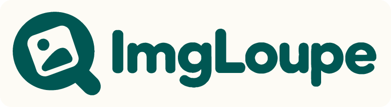

# ImgLoupe: Image Preview & Text Recognition

English · [繁體中文](README.zh-TW.md)

Preview, zoom, copy and download images in Google Docs, Sheets and Slides, recognize English and Traditional Chinese text on your device, and save every image in a document as a ZIP in one click. Requires Chrome 116 or later.

## Features

- Click an image in a document to show four actions just outside it (above its top-right corner, or on its right for narrow images): preview, copy, extract text and download.
- The preview zooms and rotates, and you can drag over part of an image to recognize just that area. Recognized text is copied to your clipboard.
- **Download all images (ZIP)** in the extension popup saves every image of the document's **current version**:
  - You don't need to scroll through the document first.
  - Images you deleted from the document are not included.
- The interface follows Chrome's UI language: Traditional Chinese for zh-TW, English for everything else.

## Supported images and limits

| Application | Images with the action toolbar |
| --- | --- |
| Google Docs | Selected images, including documents rendered on canvas |
| Google Sheets | Floating images; images inside cells have no toolbar |
| Google Slides | Images in the editing area |

- **ZIP source**: Sheets and Slides use Google's Office export (.xlsx or .pptx), the same file as File > Download. The export is served from googleusercontent.com, so the extension's background page downloads it; this is why the extension asks for access to docs.google.com and googleusercontent.com. Docs uses the document's basic mobile view instead; images are fetched at their stored size.
  - Images are numbered in document order: Slides by slide, Sheets by sheet and then by the cell each image is anchored to (IMAGE() formula images follow the embedded ones), Docs from top to bottom.
  - If Google provides neither (for example, downloading is disabled), the images already loaded in the page are packed instead, and the popup says so.
  - Image resolution is decided by Google.
  - For Docs with multiple tabs, which tabs the mobile view includes is decided by Google.
  - Sheets: floating and in-cell images come from the export. IMAGE() formula images are not embedded in the export: the original address in the formula is tried first, and when that site does not allow cross-site reads (no CORS header), or the formula has no literal address (for example IMAGE(A1)), Google's own copy from the spreadsheet's HTML view is used instead.
  - Images that still cannot be downloaded are listed in `failed-images.txt` inside the ZIP, in English, with the sheet and cell, slide or position, the address and the reason.
- **Single downloads**: these come from Google's image servers and may be limited in size, so the original upload resolution isn't guaranteed.
- **Page structure**: Google can change its page structure. When the selected image is ambiguous, ImgLoupe does nothing rather than pick a different image.

## Privacy

Text recognition and image processing run in your browser. There is no developer server, remote OCR or analytics. See the [privacy policy](PRIVACY.md).

## Build and test

Use Node 22 or later:

```sh
npm ci --ignore-scripts
npm run build
npm test
npm run check-syntax
npm run test:browser
npm run build:zip
```

**Browser tests**:
- Tests that load the extension use Playwright's Chromium (`npx playwright install chromium`).
- To run them with a local browser instead, set `IMGLOUPE_CHROME` to a Chrome for Testing or Chromium executable.

**Loading the extension manually**:
1. Run `npm run build:zip` to produce `build/imgloupe-v<version>.zip`.
2. Extract it, open `chrome://extensions/`, enable **Developer mode**, choose **Load unpacked** and select the extracted folder.
3. Reload your Google document.

**Source layout**:
- `src/` holds the source.
- `_locales/` holds the interface text.
- `vendor/tessdata-fast/` holds the hash-verified offline language models.
- `dist/` and `assets/` are generated by the build; don't edit them directly.

## License

ImgLoupe's code is released under the [MIT License](LICENSE). Third-party code and language models keep their own licenses; see [third-party notices](THIRD_PARTY_NOTICES.md).

ImgLoupe is an independent project, not affiliated with or endorsed by Google. Google Docs, Sheets, Slides and related trademarks belong to their respective owners.

## Feedback

[Open an issue](https://github.com/markleetw/imgloupe/issues) for problems or suggestions. Please don't include private documents, image URLs or recognized text in a public issue.
